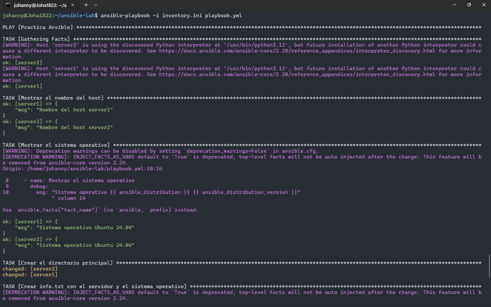
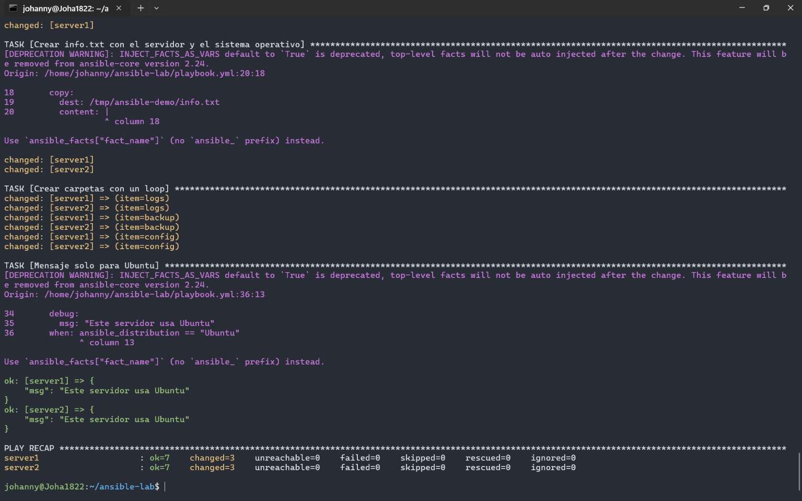

# Práctica de Ansible con Docker

## Objetivo

Crear un laboratorio con dos servidores Ubuntu en Docker y administrarlos con Ansible, usando un playbook que muestra datos de cada servidor y crea carpetas y archivos en ellos.

## Iniciar los contenedores

```bash
docker compose up -d
docker ps
```

Instalar Python en cada servidor.

```bash
docker exec server1 bash -c "apt update && apt install -y python3"
docker exec server2 bash -c "apt update && apt install -y python3"
```

Comprobar la conexión.

```bash
ansible docker -i inventory.ini -m ping
```

## Ejecutar el playbook

```bash
ansible-playbook -i inventory.ini playbook.yml
```

## Resultado


